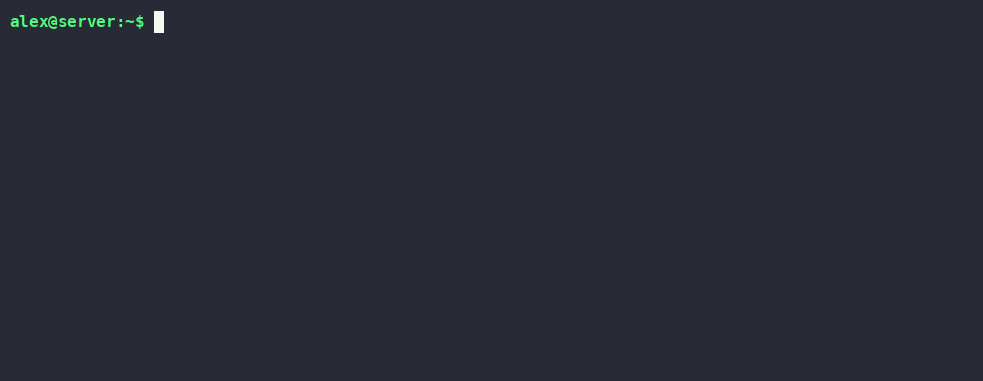

# Opute Host Agent

[](https://github.com/wunderous/opute-host-agent/actions/workflows/ci.yml)
[](https://www.npmjs.com/package/@opute/host-agent)
[](LICENSE)

**Let an AI assistant run your Linux server: VMs, K3s clusters, databases and
tunnels, through typed MCP tools that are read-only until you say otherwise.**

Opute Host Agent is an [MCP](https://modelcontextprotocol.io) server that runs
on your own machine. Connect Claude, Cursor, VS Code or any MCP client and ask
in plain language. The assistant calls typed, schema-checked tools that the
agent carries out on the host. Nothing changes on your machine until you allow
it.



*Start the agent on a server, then call it from a laptop over an SSH-forwarded
port. The laptop uses a [scripted MCP client](docs/demo/mcp.mjs) so each call
is visible. With Claude or Cursor, the assistant makes these calls for you.*

## What it can do

- **Inspect the host.** Hardware, capacity, services, files and the
  virtualization stack.
- **Run Incus VMs and system containers.** Create, start, stop, network and
  run commands in them, and probe GPU access.
- **Build K3s clusters,** including highly available ones across several VMs.
  Install Helm charts, apply manifests, and read pods, events and resources.
- **Run services on them.** PostgreSQL (CloudNativePG), an OCI registry,
  image builds and service domains.
- **Expose them safely.** Cloudflare tunnels and Tailscale through provider
  plugins.
- **Run whole setups as recipes.** A recipe is a declarative plan the agent
  runs durably, with idempotency, cancellation and a recorded result for each
  step.

The 0.5.0 catalog has 138 tools. The
[capability reference](https://www.opute.io/docs/capabilities/) lists them,
and your client sees the live list through `tools/list`.

## Safe by default

- It listens on `127.0.0.1:3014` only.
- **Every client is read-only** until it holds a grant to change the host:
  - The bearer token mutates only when the agent starts with
    `--allow-mutations`.
  - OAuth clients get a `read` or `mutate` scope each. An interactive client
    that asks for `mutate` waits for you to approve it with
    `opute-host-agent oauth approve`.
- A refused call says which grant would admit it.
- Each tool declares its effect (`readOnlyHint`, `destructiveHint`), so your
  client can ask before a destructive call.
- Secrets in results are redacted according to each tool's schema. Tools that
  reset or remove data check ownership and require an explicit confirmation.

## Quickstart

You need Linux (x64 or arm64) or WSL2, and Node.js 18 or newer.

**1. Start the agent.**

```bash
export OPUTE_REMOTE_AGENT_ID="local-$(openssl rand -hex 8)"   # this agent's identity
export MCP_AUTH_TOKEN="$(openssl rand -hex 32)"                 # the bearer token
npx -y @opute/host-agent start --background
```

The launcher downloads the release binary for your CPU, verifies its checksum
and serves MCP at `http://127.0.0.1:3014/mcp`. Run
`npx @opute/host-agent status` to check it and `npx @opute/host-agent stop` to
stop it.

**2. Connect your client.** In the same shell:

- **Claude Code:**

  ```bash
  claude mcp add --transport http opute http://127.0.0.1:3014/mcp \
    --header "Authorization: Bearer $MCP_AUTH_TOKEN"
  ```

- **Cursor, Claude Desktop and other `mcpServers` clients:**

  ```json
  {
    "mcpServers": {
      "opute": {
        "type": "http",
        "url": "http://127.0.0.1:3014/mcp",
        "headers": { "Authorization": "Bearer <your MCP_AUTH_TOKEN>" }
      }
    }
  }
  ```

- **VS Code:** follow the
  [get-started tutorial](https://www.opute.io/docs/get-started/), which keeps
  the token in a password prompt.

Keep the token out of version control.

**3. Ask.** Try *"What is this host and what can you do on it?"* The assistant
calls `get_host_info` and reads the live tool list.

**4. Allow changes when you want them.** Restart with mutations allowed:

```bash
npx @opute/host-agent stop
npx -y @opute/host-agent start --background --allow-mutations
```

The first time, the launcher creates
`~/.config/systemd/user/opute-workload.slice`. That slice holds the resource
limits every change runs under, and the agent refuses changes without it. You
can edit it to lower the limits. Creating it needs a systemd user session,
which a normal desktop or SSH login has.

Then try *"Install Incus and create a small Ubuntu VM called sandbox."* VM and
cluster tools need Incus, and `install_virtualization_stack` installs it when
the host user has the privileges to.

## Example: a website from one recipe

[`evidence/m20/minimal-site.recipe.yaml`](evidence/m20/minimal-site.recipe.yaml)
takes a host with Incus to a public website in one run. It builds an Incus
guest, installs K3s and an OCI registry, builds and deploys the site image,
and publishes it through a Cloudflare tunnel.
[`minimal-site-teardown.recipe.yaml`](evidence/m20/minimal-site-teardown.recipe.yaml)
removes all of it. Recipes like these run on every release candidate, on a
disposable VM.

## Example: a local model from one recipe

[`docs/recipes/local-llm.recipe.yaml`](docs/recipes/local-llm.recipe.yaml)
installs Ollama from its pinned upstream release, pulls a small model and
checks a streaming chat reply before it marks the runtime active. It needs no
GPU and agent 0.5.4 or later. On the project's test VM (8 vCPU, no GPU) the
run took 5 min 20 s, most of it downloading, and the first token of a reply
came after 95 ms. [Run a local model](docs/recipes/local-llm.md) has the
steps, the measurements and how to clean up.

## Install without npm

Each [GitHub release](https://github.com/wunderous/opute-host-agent/releases)
ships Linux x64 and arm64 binaries, the K3s, Cloudflare and Tailscale provider
plugins, `SHA256SUMS` and a CycloneDX SBOM. To build from source with the
pinned Rust toolchain:

```bash
make rust-build                      # target/release/opute-host-agent
./target/release/opute-host-agent    # serves MCP over HTTP on 127.0.0.1:3014
```

Configuration is environment-based. See the
[configuration reference](https://www.opute.io/docs/configuration/).

## Documentation

- [Get started](https://www.opute.io/docs/get-started/)
- [Install and run](https://www.opute.io/docs/install/)
- [Connect an MCP client](https://www.opute.io/docs/mcp-clients/)
- [Concepts](https://www.opute.io/docs/concepts/)
- [Recipes and plans](https://www.opute.io/docs/recipes/)
- [Resources and safety](https://www.opute.io/docs/resources/)
- [Troubleshooting](https://www.opute.io/docs/troubleshooting/)
- [How this project is built](docs/engineering.md): the specification,
  decisions, evidence and release gates kept in this repository

## Status and limits

- 0.5.3 is the current release. Each release is accepted on end-to-end
  journeys that run on a disposable VM, including rollback to the previous
  release.
- Hosts must run Linux or WSL2. Native macOS and Windows hosts aren't
  supported.
- Transport is Streamable HTTP only. stdio isn't supported.
- The tool contract may still change between minor versions. The release
  notes say what changed.

## Related repositories

[`wunderous/host-agents`](https://github.com/wunderous/host-agents) holds the
npm launcher, the [www.opute.io](https://www.opute.io) documentation site and
the frozen Go implementation, which is kept as a rollback target.

## Contributing

Issues and pull requests are welcome. Read [CONTRIBUTING.md](CONTRIBUTING.md)
first, and report vulnerabilities privately as described in
[SECURITY.md](SECURITY.md). Everyone taking part follows the
[Code of Conduct](CODE_OF_CONDUCT.md).

## License

[MIT](LICENSE)
